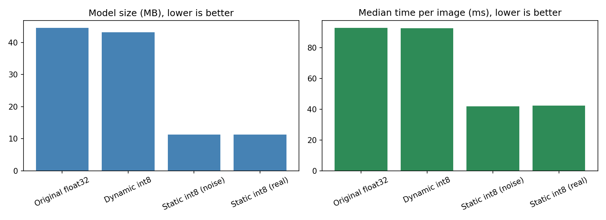

# Making ResNet-18 Smaller and Faster for Offline, Low-Resource Devices

This project tests how much a pretrained ResNet-18 image classifier can be shrunk with int8 quantization so it can run on weak computers with no reliable internet.

**Research question:** How can an AI model be optimized to reduce its memory, storage, and compute requirements while keeping useful performance in resource-constrained environments?

## Main result

| Method | Size (MB) | Median speed (ms/image) | Agreement with original |
|---|---|---|---|
| Original float32 | 44.59 | 92.97 | 100% (itself) |
| Dynamic int8 (last layer only) | 43.13 | 92.54 | 98.0% (first 1,000 images) |
| Static int8, noise calibration | 11.29 | 41.98 | 93.54% (3,669 images) |
| Static int8, real-image calibration | 11.29 | 42.34 | 95.72% (3,669 images) |

- Static int8 quantization of the whole network made the model about 4x smaller and about 2.2x faster.
- Top-1 agreement with the original was 95.72%. The original's top answer appeared in the shrunk model's top 5 on 100% of the 3,669 test images.
- Dynamic quantization only changes the final linear layer (about 4% of the weights), so it saved about 3% of the size and gave no speedup.
- Calibrating with 100 real images beat calibrating with random noise (95.72% vs 93.54% agreement).

## What was done

1. Loaded the pretrained quantization-ready ResNet-18 from torchvision.
2. Fused Conv + BatchNorm + ReLU layers.
3. Attached observers, calibrated, and converted to a true int8 model (static post-training quantization).
4. Compared two calibration data choices: random noise and 100 real images from the trainval split.
5. Tested on the full Oxford-IIIT Pet test split (3,669 images).
6. Timed models with a warm-up, the median of 100 runs, 5 repeated rounds, and 1 CPU thread.
7. Saved the final model as TorchScript (resnet18_int8.pt, 11.42 MB).
8. Ran the saved file in a fresh Python process with network functions disabled (offline_predict.py). It gave the same answer as the in-memory model.

## Files

- resnet18_int8.pt : the saved int8 model (TorchScript)
- offline_predict.py : loads the model file and predicts, with network functions blocked
- results.csv and results.png : the results table and graph
- environment.json : software and hardware used
- test_pet.jpg : a sample image from the Oxford-IIIT Pet dataset

## How to run offline prediction

    python offline_predict.py test_pet.jpg

The script only needs PyTorch, torchvision, Pillow, and the model file. It prints a class index from the 1,000 ImageNet classes.

## Environment

Python 3.13.16, PyTorch 2.11.0 (CPU), torchvision 0.26.0, Intel Xeon @ 2.20GHz (2 cores available), int8 engine fbgemm (x86), 1 thread for timing, Google Colab.

## Limitations

- **Agreement, not accuracy.** I compared the shrunk model with the original model, not with true labels. The model predicts 1,000 ImageNet classes while the dataset has 37 pet breeds, so a direct accuracy test was not possible.
- One model, one dataset, one CPU, batch size 1, 1 thread.
- Tested on x86 (fbgemm) only. Phones usually use ARM (qnnpack), which was not tested.
- Timing was done on a shared cloud machine, so some rounds were slower (for example 104 ms and 47 ms).
- Only 100 calibration images were used, and the effect of using more or fewer was not studied.
- Dynamic agreement used 1,000 images while static used 3,669, so those two numbers are not perfectly comparable.
- The offline test disabled network functions in software, used a single image, and was not a physical disconnect. Its 206 ms time was a cold start, not steady-state speed.
- Peak memory and energy were not measured.
- torch.ao.quantization is deprecated and is moving to torchao.

## Future work

- True accuracy on labeled data (for example ImageNet validation), or fine-tuning on the pet classes.
- Quantization-aware training, pruning, and distillation.
- Other models built for small devices, and real hardware tests (Raspberry Pi, Android with qnnpack).
- Peak memory and energy measurements.
- A study of how many calibration images are needed.
- Confidence intervals on the agreement numbers.
- Migration to torchao.

## Dataset

Oxford-IIIT Pet Dataset (via torchvision.datasets.OxfordIIITPet). Please check its license before reusing the images.

## Author

YOUR NAME HERE
